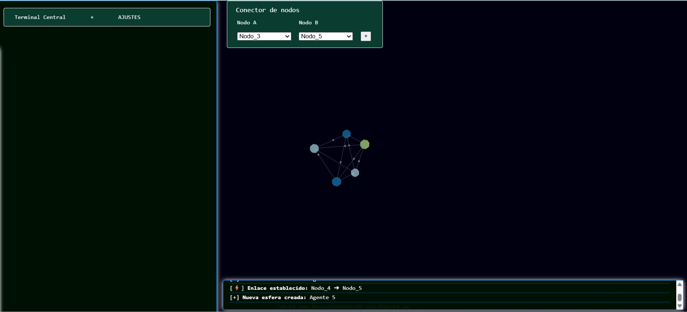
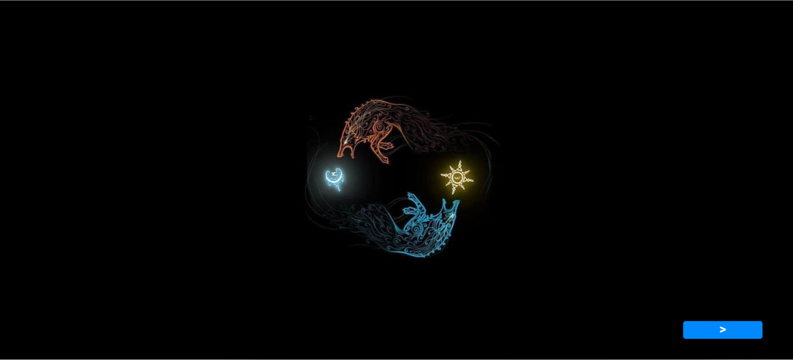
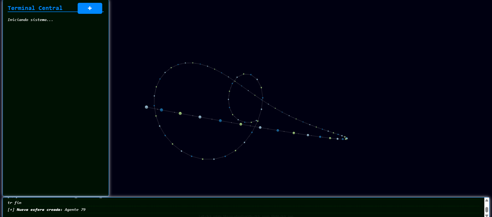
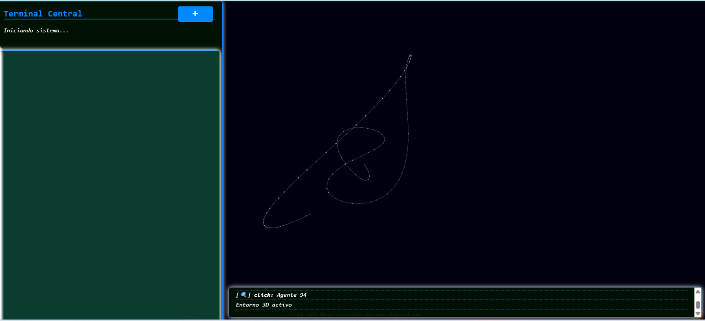

# Skoll-and-Hati
Sistema multi-agente de IA completamente privado y offline, Visualización en tiempo real mediante una interfaz 3D HTML/JS,

## Estado Actual
<b>El proyecto se encuentra en sus primeros pasos de desarrollo en esta sección se muestra la interfaz más actualizada del mismo</b>

## 📅 Diario de Desarrollo

  
<b>18/09/2026:</b>

   
  

  

  
<b>23/09/2026:</b>

   
  

  

  
<b>14/10/2026</b>

   
  

  

  
<b>04/11/2026</b>

   
  

  

